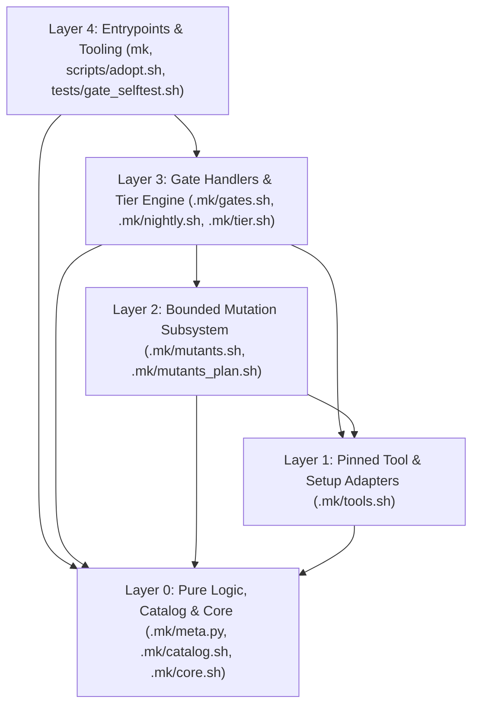
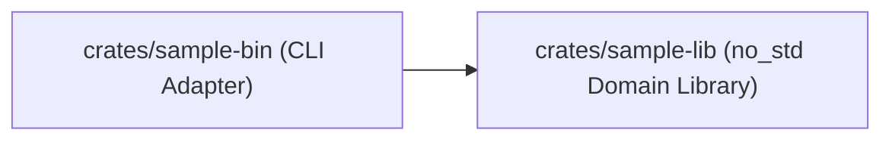

# Architecture

`rusti-graben` is a zero-drift Rust quality-hygiene template and adoption runner. Its architecture keeps local runs, git hooks, and CI workflows identical by funneling every check through a single shell entrypoint (`./mk`) backed by strictly layered, single-responsibility modules.

## Glossary

| Term | Meaning |
|---|---|
| **Standard runner** | The synced runner files (`mk`, `mk.versions`, `.mk/*`, `.github/actions/setup/action.yml`) kept identical across adopted repositories by `scripts/adopt.sh`. |
| **Local config** | Repository-specific configuration and extensions in `mk.local` (`LOCAL_CI_GATES`, `LOCAL_OVERRIDES`, `MUTANTS_PACKAGES`, ratchets), never overwritten by `scripts/adopt.sh`. |
| **Gate** | An atomic verification step invoked as `./mk <gate>` (returning `0` on pass, `78` on tier skip, `1` on failure). |
| **Tier** | A named sequence of gates executed by `run_tier` (`check`, `ci-fast`, `ci-core`, `ci`, `ci-nightly-checks`, `ci-nightly`, `ci-release`). |
| **Ratchet** | A monotonic quality floor checked by `./mk ratchet` against the base branch (`COVERAGE_FAIL_UNDER_LINES`, `ECHOES_MAX_*`, and `Cargo.toml` lint allows). |
| **Baseline** | The initial recorded ratchet value written to `mk.local` via `./mk coverage-baseline` or `./mk echoes-baseline`. |
| **Affected packages** | Workspace crates owning changed files plus their transitive workspace reverse-dependents, computed by `.mk/meta.py`. |
| **Selftest** | Template-only failure-injection suite (`./mk selftest`) proving every gate fails on a synthetic violation and `scripts/adopt.sh` stays idempotent. |

## Layered Dependency Rule

Dependencies flow strictly downward from entrypoints to pure domain logic:

Within the sample Rust workspace, dependencies follow the same one-way domain-to-adapter boundary:

- **No upward or cyclic dependencies**: Layer 0 (`.mk/meta.py`, `.mk/catalog.sh`, `.mk/core.sh`) never calls gate handlers, tool installers, or mutation watchdogs. `crates/sample-lib` is `#![cfg_attr(not(feature = "std"), no_std)]` with zero I/O or external dependencies.
- **Zero-Rust-prerequisite bootstrap**: The runner uses POSIX/Bash + Python 3 stdlib so `./mk setup` and `./mk ci` execute in fresh checkouts without compiling a Rust runner binary or polluting adopted repositories' `Cargo.toml` and `Cargo.lock`.

## Component Responsibilities

Each file and module owns one cohesive responsibility:

| Layer | Component | Responsibility |
|---|---|---|
| Layer 0 | `.mk/meta.py` | Pure `cargo metadata` parsing, workspace reverse-dependency graph traversal, shard math, and compact JSON plan formatting. |
| Layer 0 | `.mk/catalog.sh` | Declarative gate registry, tier lists, alias normalization, descriptions, failure hints, and CLI help/list formatting. |
| Layer 0 | `.mk/core.sh` | Foundational `die`/`skip` exits, git diff helpers, docs-only diff classifier, config key upserts, and `.mk/meta.py` runner (`meta_py`). |
| Layer 1 | `.mk/tools.sh` | Version spec parsing, `MK_TOOLS_DIR` `PATH` isolation, `$CARGO_HOME/bin` seeding, unified tarball/binstall installers, `setup`, and `tools`. |
| Layer 2 | `.mk/mutants.sh` | Resource starvation probes, flag/config inspection, CPU/thread budgeting, atomic lockdir, process-group watchdog, and `run_mutants`. |
| Layer 2 | `.mk/mutants_plan.sh` | Mutation scope filtering, `mutants-diff`, `mutants-affected`, and `mutants-plan` JSON output. |
| Layer 3 | `.mk/gates.sh` | Single-purpose command handlers for inner-loop, hygiene, security, supply-chain, and ratchet gates. |
| Layer 3 | `.mk/nightly.sh` | Nightly coverage/powerset/miri/outdated handlers, release dry-run, template selftest, and fallback dispatch. |
| Layer 3 | `.mk/tier.sh` | `cargo-make` bridge, `LOCAL_OVERRIDES` safety guard/dispatch, tier loop runner, and nightly idle-run short-circuiting. |
| Layer 4 | `mk` | Thin entrypoint sourcing config and `.mk/` modules, normalizing aliases, checking overrides, and dispatching commands. |
| Layer 4 | `mk.versions` | Single source of truth for pinned nightly toolchain, `cargo-binstall` crate versions, `tombi`, and `shellcheck`. |
| Layer 4 | `mk.local` | Repository-specific gate additions, overrides, extra tools, package scopes, and monotonic ratchets. |
| Layer 4 | `scripts/adopt.sh` | Modular idempotent adoption and sync runner for `mk`, `mk.versions`, `.mk/*`, setup action, gate configs, lints, and contributor docs. |
| Layer 4 | `tests/gate_selftest.sh` & `tests/selftest/*.sh` | Scratch-repo failure-injection harness, modular gate suites, fast unit/characterization suite, and adoption fixture suite. |
| Layer 4 | `tests/test_meta.py` | Unit and seeded-DAG property tests for pure metadata, package-graph, and shard-planning logic in `.mk/meta.py`. |
| Sample Domain | `crates/sample-lib` | Minimal `no_std`-capable library exposing `sample_lib::add`, doctests, README doctest, and mutant-killing tests. |
| Sample Adapter | `crates/sample-bin` | Minimal CLI binary printing `sample_lib::add(10, 20)` with process-level integration test coverage. |

## Public Contracts, Errors, and Concurrency

### Runner Exit & Output Contract

- Exit `0`: command succeeded (or skipped via `skip` when invoked directly).
- Exit `78` (`SKIP_RC`): gate inapplicable during nested tier execution (`MK_NESTED=1`).
- Exit `1`: hard failure emitted via `die()` to `stderr` (missing/drifted tool, failed gate, invalid numeric ratchet, or forbidden override).
- Plain deterministic output when `NO_COLOR` is non-empty or `CI=1` (`CARGO_TERM_COLOR=never`, `NO_COLOR=1`).
- `./mk mutants-plan --mode <diff|affected|full> [--base <ref>]`: emits single-line compact JSON `{"mode":...,"mutants":N,"shards":S,"packages":[...]}`.

### Python & Error Handling Strategy

- Pure functions in `.mk/meta.py` validate inputs explicitly and raise `ValueError` with contextual diagnostics; the CLI entrypoint maps errors to `stderr` and exit code `1`.
- All `cargo metadata` inspection across `mk` and `scripts/adopt.sh` flows through `.mk/meta.py` (`json.loads`); regex-based JSON parsing in shell is forbidden.

### Concurrency & Process-Group Watchdog

- `run_mutants` enables job control (`set -m`) around `nice -n 19 cargo mutants` so `SIGINT`/`SIGTERM` and watchdog shutdowns signal the entire process group (`kill -INT -- "-$pid"`, escalating to `SIGKILL` after 30s).
- Out-of-place single-job local runs share `.../target/mutants` guarded by an atomic `mkdir` lockdir recording the owner PID and cleaning stale locks if that PID is dead; multi-job parallel runs unset `CARGO_TARGET_DIR` for scratch isolation.

## Design Invariants

1. **Zero drift between local and CI**: `.github/workflows/*.yml` and `prek.toml` call `./mk <task>` exclusively. `.github/actions/setup/action.yml` caches `MK_TOOLS_DIR` (`~/.cargo/mk-tools`).
2. **Standard vs. local split**: `mk`, `mk.versions`, `.mk/*`, and `.github/actions/setup/action.yml` stay identical across adopted repositories and are synced by `scripts/adopt.sh`. Repo-specific settings live in `mk.local`.
3. **Hard failure on tool drift**: `tools` verifies exact pinned versions from `mk.versions` before running any gate.
4. **Ratchets only tighten**: `./mk ratchet` compares `Cargo.toml` lint allows, `COVERAGE_FAIL_UNDER_LINES`, and `ECHOES_MAX_*` against the merge-base and rejects any loosening.
5. **Bounded mutation testing**: `LOCAL_OVERRIDES` cannot replace `mutants`, `mutants-diff`, or `mutants-affected`; the watchdog enforces `MUTANTS_MIN_FREE_MEM_PCT` (15%) and `MUTANTS_MIN_FREE_DISK_GB` (10 GB).
